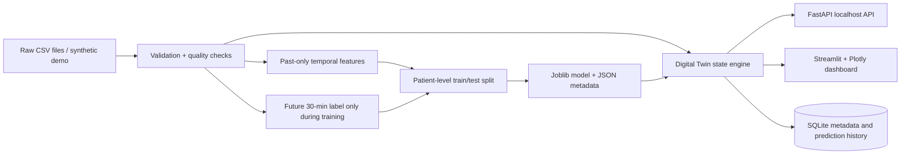

# HypoGuard Twin

**AI-powered digital twin prototype for early hypoglycaemia-event prediction.** HypoGuard Twin estimates whether at least one *recorded valid glucose observation* may fall below 70 mg/dL in the next 30 minutes. It is built for the Happiest Health Digital Twin Challenge 2026.

> **Clinical safety:** This is an educational research prototype, not a medical device or clinical decision-support tool. It is not validated for patient care and never provides a diagnosis, treatment recommendation, or insulin-dose advice.

## What is implemented

- Leakage-safe timestamped CSV ingestion with delimiter detection, column normalization, validation, data-quality summaries, and preserved patient IDs.
- Temporal feature construction from current and prior observations only; separate future-window target construction.
- Deterministic synthetic demonstration data when `data/raw/` is empty, prominently labelled as synthetic.
- CPU-friendly scikit-learn baseline and Random Forest, strict patient-level split, joblib persistence, and reproducible evaluation metadata.
- Patient-state engine, SQLite metadata/prediction history, FastAPI service, Streamlit/Plotly dashboard, historical replay, and constrained hypothetical scenario comparison.

## Architecture



See [architecture documentation](docs/architecture.md) for data flow and safety boundaries.

## Quick start (synthetic demonstration)

Requires Python 3.10–3.13. Python 3.14 is currently available in this workspace, but some third-party packages may not yet publish wheels for it; use a supported interpreter if dependency installation fails.

```bash
cd "/path/to/twin challenge"
python3 -m venv .venv
source .venv/bin/activate
python -m pip install --upgrade pip
python -m pip install -r requirements.txt
python -m scripts.train --mode synthetic
uvicorn hypoguard_twin.api:app --host 127.0.0.1 --port 8000
```

In a second terminal:

```bash
cd "/path/to/twin challenge"
source .venv/bin/activate
streamlit run dashboard.py
```

Open `http://127.0.0.1:8000/docs` for interactive API documentation and the Streamlit URL printed by the dashboard. The server deliberately binds only to localhost.

## Tests and smoke checks

```bash
python -m pytest -q
python -m scripts.train --mode synthetic
curl http://127.0.0.1:8000/health
curl -X POST http://127.0.0.1:8000/predict -H 'content-type: application/json' -d '{"patient_id":"SYN-001"}'
```

## Real dataset import

The HUPA-UCM Diabetes Dataset landing page is [Mendeley Data](https://data.mendeley.com/datasets/3hbcscwz44/1); consult the dataset’s landing page/paper and its licence before downloading, using, or redistributing it. This project does **not** download it automatically and excludes `data/raw/` from Git.

1. Obtain the data lawfully and inspect its documentation, including special-value conventions.
2. Put one or more patient CSVs under `data/raw/`. Each file needs a timestamp-like column and glucose-like column. Supported aliases are documented in [data dictionary](docs/data_dictionary.md).
3. Do not merge multiple people into a fabricated continuous series; retain a patient ID per file or a `patient_id` column.
4. Run `python -m scripts.train --mode real` and review `artifacts/model_metadata.json` before interpreting the model.

## Prediction target and evaluation

For an observation at time *t*, target = 1 only when at least one valid measured glucose value below 70 mg/dL exists in `(t, t + 30 minutes]`; target = 0 when valid future glucose exists in that window but none is below 70. Rows lacking an in-window future measurement are excluded from training/evaluation. Features look backward only.

The default split separates whole patient identifiers. It reports precision, recall, F1, false positives/negatives, confusion matrix, and PR-AUC/ROC-AUC only when the held-out set has both classes. Synthetic metrics, if generated, are explicitly technical smoke-test results—not clinical evidence. See [model evaluation](docs/model_evaluation.md).

## Repository layout

```text
hypoguard_twin/       ingestion, features, model, twin, persistence, API
scripts/train.py      reproducible local training command
dashboard.py          Streamlit dashboard
tests/                deterministic automated tests
data/raw/             user-supplied, ignored real dataset files
data/synthetic/       generated demonstration CSVs, ignored
artifacts/            generated model + metadata, ignored
docs/                 architecture, data, limitations, demo material
```

## Challenge submission information

Complete every placeholder below before submitting to Unstop. Do not claim a requirement is complete until the corresponding material exists and the link has been tested.

### Team and institution
- **Project title:** HypoGuard Twin — AI-powered digital twin prototype for early hypoglycaemia-event prediction
- **Team name:** `[ADD TEAM NAME]`
- **Team leader:** `[ADD NAME]`
- **Team members and roles:** `[ADD ALL MEMBERS AND ROLES]`
- **College/institution:** JECRC Foundation, Jaipur, Rajasthan, India
- **Incubator/innovation centre:** `[ADD VERIFIED DETAILS OR N/A]`
- **Contact details:** `[ADD AS REQUIRED BY THE CHALLENGE]`

### Healthcare use case
The prototype explores whether, at observation time *t*, at least one **valid recorded glucose measurement** below 70 mg/dL will occur in `(t, t + 30 minutes]`. It demonstrates a time-aware patient-state representation, a local model, data-quality reporting, historical replay, and an interactive dashboard. Missing future readings are not treated as proof that no event occurred.

**Intended use:** technical research and demonstration only. This is not a medical device or clinical decision-support system and must not be used to make treatment, insulin, medication, food, or exercise decisions.

### Technical stack
Python; pandas; NumPy; scikit-learn; joblib; FastAPI; Uvicorn; Pydantic; Streamlit; Plotly; SQLite; pytest; HTTPX.

### AI/ML model and framework details
- Baseline: `DummyClassifier(strategy="prior")`.
- Candidate: CPU-friendly scikit-learn Random Forest (120 trees, maximum depth 8, one worker).
- Features use current and prior observations; future readings are used only to construct training labels.
- Patient identifiers are split at patient level to reduce leakage.
- Model estimates are uncalibrated. Synthetic evaluation results are technical demonstration results only, not clinical evidence.
- See [model evaluation](docs/model_evaluation.md) and [limitations and safety](docs/limitations.md).

### Mandatory demo video
- **Video length:** 15–20 minutes.
- **Hosting:** YouTube set to **Unlisted**.
- **Video URL:** `[ADD UNLISTED YOUTUBE LINK]`
- The link must also be included here in the README and tested in a private/logged-out browser.
- The [demo script](docs/demo_script.md) provides a suggested run-of-show; it is not a substitute for the uploaded video.

### Mandatory architecture diagram and presentation
- **Architecture diagram PDF/PPT:** `[ADD LINK OR PATH AFTER CREATING THE PDF/PPT]`
- **Project presentation PDF/PPT:** `[ADD LINK OR PATH AFTER CREATING THE PDF/PPT]`
- `docs/architecture.md` is the architecture source/documentation, but the challenge separately requests an architecture diagram in PDF/PPT format.
- `docs/presentation_outline.md` is an outline, not the final presentation PDF/PPT.
- `docs/screenshots.md` contains screenshot guidance/placeholders; add genuine screenshots if you use them in the presentation.

### Open-source license
The repository includes an MIT `LICENSE` file. Fill in and verify the copyright/team details before submission. Dataset licensing and attribution are separate from the source-code licence.

### Public accessibility
The GitHub repository must be public. The demo, architecture document, presentation, and any other linked files must open without additional permissions. Never publish private health data, credentials, secrets, or datasets unless sharing is explicitly permitted.

## GitHub submission

```bash
git init
git add .
git commit -m "Initial HypoGuard Twin prototype"
git branch -M main
git remote add origin YOUR_GITHUB_REPOSITORY_URL
git push -u origin main
```

Review `git status` first. Never push patient data, credentials, `.env`, downloaded datasets, or generated databases/models unless you have explicit permission and the data licence permits it.

## Licence

This repository uses the MIT License with a team-name placeholder. Dataset licence/attribution remains separate and must follow the original source.
