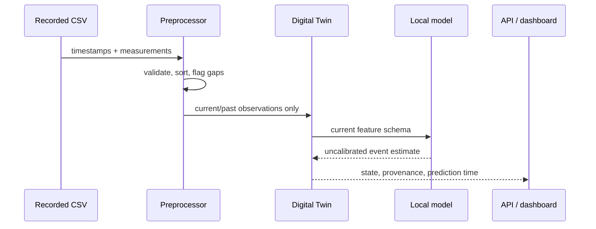

# Architecture

HypoGuard Twin has a deliberately small local architecture for an Apple Silicon laptop: pandas/NumPy preprocessing, scikit-learn CPU inference, SQLite metadata, FastAPI, and Streamlit.

The trainer separately creates future-window labels. It never sends future glucose readings to the feature builder. Dataset observations are kept in CSV rather than duplicated in SQLite; SQLite stores small state/prediction/model metadata records.

Replay creates a temporary state engine and sequentially adds only the selected prefix of recorded observations, so later rows cannot influence replay features.

Scenario comparison is likewise isolated: it accepts only bounded recorded activity, carbohydrate, or heart-rate inputs. It neither mutates the twin’s recorded observations/state nor writes an extra prediction-history record. Model-derived glucose features are intentionally not directly mutable because that would create an internally inconsistent hypothetical input vector.
